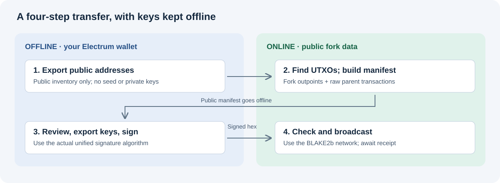

# BTCB2 offline sweeping tools

Two Python bundles for claiming Bitcoin BIP110 (BLAKE2b / BTCB2) fork outputs using offline signing with `SIGHASH_ALL | SIGHASH_UNIFIED` (`0x21`). Private keys stay on your offline computer.

## Choose your bundle

| Inputs you are spending | Guide and source | Download |
|---|---|---|
| Native SegWit P2WPKH (`bc1q…`, 20-byte witness program) | [SegWit guide](segwit/README.md) | [SegWit ZIP](bundles/btcb2-segwit.zip) |
| Legacy P2PKH (`1…`), compressed keys | [Legacy guide](legacy/README.md) | [Legacy ZIP](bundles/btcb2-legacy.zip) |

Choose by **input type**, not destination. Both support P2PKH and native P2WPKH destinations. Do not mix scripts or manifests between bundles. P2SH, multisig, Taproot and uncompressed keys are unsupported. The Electrum helpers require standard deterministic zpub-based SegWit or xpub-based legacy wallets; imported keys and old non-BIP32 wallets are not supported by those helpers.

## Workflow

1. **Offline Electrum:** use `electrum_helpers.py` to export a public address inventory for receiving and change branches.
2. **Online:** use `build_manifest.py` to query current fork UTXOs, check the fork checkpoint and fetch raw parent transactions. The default explorer is `mempool.guide`; `--api` selects another compatible HTTPS Esplora endpoint. Review exclusions and your address range.
3. **Offline Electrum:** export only the keys required by the manifest, using `export_manifest_keys`. Keep the resulting `keys.txt` offline.
4. **Offline:** run `offline_sweep.py --plan-only`, review destination, inputs, amounts and fees, then sign using `--reviewed-plan`. Follow the exact commands in your bundle's guide.
5. **Online:** transfer signed transaction hex and public reports, validate with a fork node, and broadcast on BTCB2. Confirm the receiving service explicitly supports BTCB2/BLAKE2b.

An address inventory is **not** a signing manifest. Current BTC unspentness does not establish current fork unspentness. A later spend of a consolidation output needs a fresh manifest and the corresponding key.



## Requirements and limits

Install Python and `cryptography` before taking the signing machine offline. Electrum console helpers use Electrum's own runtime. Neither signer broadcasts transactions or needs network access. Never share seeds, passwords, wallet files or exported private keys. Public inventories and manifests reveal wallet activity too.

These are **unaudited review prototypes**. Correct unified signatures use a different signing message from BTC; merely adding a `0x21` suffix is not replay protection. Ordinary BTC signatures may still replay on the fork. Keep your original wallet and seed backups, which can still control BTC.

The suites use synthetic keys, upstream digest vectors and signature/serialization checks. Explorer and Electrum integrations are mocked; these bundles have not undergone independent full-node validation or a security audit. From the selected bundle directory, run:

```sh
python -m unittest discover -v
```

Each bundle includes `SHA256SUMS`; ZIP hashes are in [bundles/SHA256SUMS](bundles/SHA256SUMS). Hashes detect changes relative to a trusted copy; they are not an audit.

## References

- [Pinned Knots unified-sighash specification](https://github.com/bitcoinknots/bitcoin/blob/v29.4.1.knots20260508/doc/unified-sighash.md)
- [Upstream test vectors](https://github.com/bitcoinknots/bitcoin/blob/v29.4.1.knots20260508/src/test/data/unified_sighash.json)
- [Fork developer documentation](https://bitcoin-blake2b.org/developers)

Upstream fixture license text is included in each bundle as `UPSTREAM_COPYING`.
