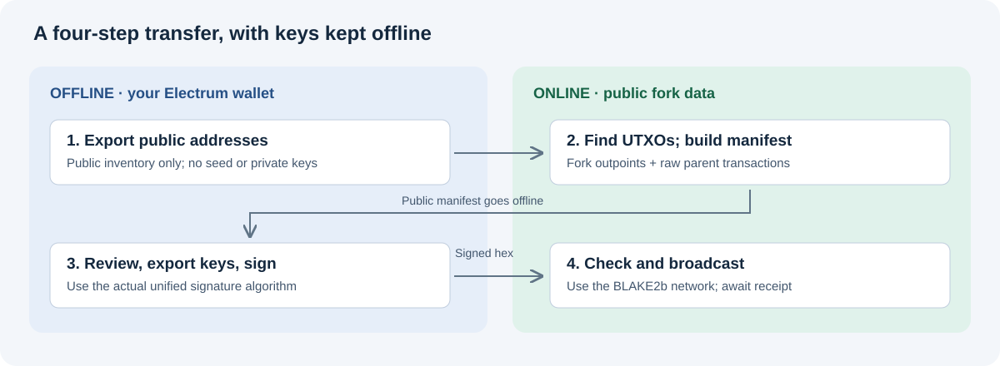
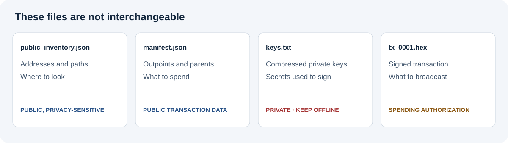

# How to claim BTCB2 fork coins while keeping your BTC separate

**A practical guide for Electrum users with native SegWit wallets. Updated 7 September 2026.**

This guide uses **BTC** for the SHA256d Bitcoin chain and **BTCB2** for the BLAKE2b fork. Exchanges may use different names. Holding BTC before a split does not create a second seed: the same private keys can control outputs on both chains, whose spending histories can subsequently diverge.

The workflow is: **identify fork UTXOs online → prepare public transaction data → sign offline with replay protection → broadcast only on the fork → verify receipt.** No seed or private key needs to leave your offline machine.



## 1. Understand the protection before exporting anything

For the split discussed here, the shared snapshot ends at block **961631**, before divergence at **961632**. BLAKE2b and unified signing activated later, at **961640**. These are different boundaries. See the [BIP110 deployment specification](https://github.com/bitcoin/bips/blob/master/bip-0110.mediawiki) and the [fork developer documentation](https://bitcoin-blake2b.org/developers).

Changing the mining algorithm alone does not prevent transaction replay. This workflow uses **SIGHASH_ALL | SIGHASH_UNIFIED**, represented by the signature byte **0x21**. It signs a different message from BTC's algorithm, so correctly produced signatures fail verification on BTC. Simply appending `21` to an ordinary signature does not work.

Protection is one-way: ordinary BTC transactions can still be replayed on the fork while their inputs are available there. A protected fork spend must confirm before you rely on those particular inputs being separated. Under this unified-signing method, no special fork-only “seed” input is required. [Unified signature-hash specification](https://raw.githubusercontent.com/bitcoinknots/bitcoin/v29.4.1.knots20260508/doc/unified-sighash.md)

## 2. Choose a supported workflow

The included `offline_sweep.py` handles **single-signature native SegWit inputs**: witness-v0 P2WPKH, normally `bc1q` addresses with 20-byte witness programs. Not every `bc1q` address is P2WPKH. The output can be native P2WPKH or a mainnet legacy P2PKH address beginning with `1`.

It does **not** support multisig/P2WSH inputs, Taproot inputs, legacy inputs, hardware-wallet signing, or PSBT signing. Do not convert a different wallet into this workflow by guessing its derivation path.

This is a technical workflow using a **review-prototype signer**, not an audited wallet. Its Python tests covered applicable upstream vectors, signature verification, BTC rejection, serialization, fees and the legacy destination extension. The extended version has not been independently validated here in a full fork node. Verify the supplied checksums and review the code before using it.

A wallet with documented unified-signing support is another route. For example, [Shrike documents its replay-protection status and limitations](https://shrikewallet.com/docs/replay-protection.html). Its documentation also says it can fall back to ordinary signing in some circumstances: check the actual protection status, rather than assuming the application name guarantees it. This is a reference, not an audit or endorsement.

## 3. Separate the online and offline jobs

| Online computer | Offline computer |
|---|---|
| Public addresses or zpub | Existing Electrum wallet and private keys |
| Fork explorer/node queries | Reviewed signing software and dependencies |
| Manifest and unsigned review plan | Local key export and transaction signing |
| Broadcasting signed transaction hex | Seed backup remains private |

A zpub cannot spend funds, but it reveals wallet activity. Queries to a public explorer also reveal the addresses or transaction IDs queried. Use your own server where practical. Never upload a seed, private key, wallet password or `keys.txt` to a website, chatbot or explorer.

Prepare and verify software on the online side before transferring it offline. The included signer requires Python and `cryptography`; it does not install dependencies or access the network itself.

## 4. Find your addresses and the fork's current unspent outputs

In a standard Electrum deterministic wallet, receiving and change addresses normally use suffixes **0/index** and **1/index** relative to the wallet's master public key. Scan both. Do not automatically prepend `m/84'/0'/0'`: the correct root depends on how the wallet was created.

For a small wallet, use Electrum's address list. For a large wallet, derive and scan addresses from the public key with a compatible watch-only tool. Record each address and its derivation suffix.

The included helper can export both branches directly from your offline Electrum wallet. Adjust the file paths for your machine and run in its console:

```python
exec(open(r'C:\offline\electrum_helpers.py', encoding='utf-8').read())
export_public_inventory(r'C:\offline\public_inventory.json', per_branch=2000)
```

This derives 2,000 addresses per branch without changing the wallet's gap limit. It creates **public data only**, including the zpub. Copy `public_inventory.json` to the online computer; never substitute a wallet file or seed.

Choose bounds deliberately. Scanning 2,000 per branch is a cap, not proof that later addresses are unused. Likewise, stopping after 51 consecutive addresses without history can miss later activity. A zero-balance address is not necessarily unused.

**Query the BLAKE2b fork for current unspentness.** A BTC explorer can provide shared pre-split transactions, but BTC's current UTXO list is not the fork's list.

At the time of writing, [mempool.guide](https://mempool.guide/) serves the fork. Useful public API requests are:

```text
GET https://mempool.guide/api/block-height/961640
GET https://mempool.guide/api/blocks/tip/hash
GET https://mempool.guide/api/block/BLOCK_HASH
GET https://mempool.guide/api/address/YOUR_ADDRESS/utxo
GET https://mempool.guide/api/tx/TRANSACTION_ID/hex
GET https://mempool.guide/api/tx/TRANSACTION_ID/outspends
```

The first BLAKE2b block should match the release checkpoint:

```text
0000000000000050c1e5f69672f459293be14f46e5a494e7a8c8541396f18eeb
```

The checkpoint appears in the [release's mainnet chain parameters](https://github.com/bitcoinknots/bitcoin/blob/v29.4.1.knots20260508/src/kernel/chainparams.cpp). A matching checkpoint identifies the reported chain; it does not turn an explorer response into independent full-node validation.

An `/utxo` row identifies a particular output using `txid` and `vout`, with its amount and confirmation status. Include confirmed, spendable outputs only. Fetch each distinct parent transaction's raw hex. If starting from a historical inventory, check every candidate's outspend status on the fork and exclude already-spent outputs.

For many addresses, automate these requests with modest concurrency and retries. Do not silently treat a failed request as an empty address. Record the chain tip and recheck it across the final query round so the manifest describes a consistent snapshot.

If an old output is spent, inspect its spending transaction. Some value may remain in change that you control. Trace that change or rescan the wallet's fork history before claiming the inventory is complete. “I haven't spent today” does not establish that every pre-split output remains unspent.

## 5. Build `manifest.json`—not just an address list

There are two different files:

| File | Purpose |
|---|---|
| Address/path list | Identifies which wallet keys correspond to addresses |
| Signing manifest | Identifies exact unspent outputs and contains their raw parent transactions |

**An address balance or `funded_paths.json` cannot substitute for the signing manifest.** One address may hold several UTXOs.



The included `example_manifest.json` shows the schema and contains intentionally invalid placeholders. Replace them with your own public data:

```json
{
  "format": "offline-p2wpkh-sweep/v2",
  "signing_profile": "knots-unified-p2wpkh-0x21/v2",
  "snapshot": {
    "height": 961640,
    "block_hash": "ACTUAL_FORK_SNAPSHOT_HASH"
  },
  "transactions": {
    "PARENT_TXID": "FULL_RAW_PARENT_TRANSACTION_HEX"
  },
  "utxos": [
    {
      "txid": "PARENT_TXID",
      "vout": 0,
      "value_sats": 100000,
      "script_pubkey": "0014YOUR_20_BYTE_PUBLIC_KEY_HASH"
    }
  ]
}
```

Use the **actual checked snapshot height and hash**, at or after activation. Do not invent them or relabel the pre-split snapshot. Each `vout` is a zero-based output index. Each amount is an integer number of satoshis. The `script_pubkey` is the output script, not an address or private key.

The signer recomputes parent transaction IDs and checks selected amounts and scripts against the raw bytes. It cannot independently prove current unspentness, block inclusion or chain activation. Direct coinbase inputs additionally require the supported `confirmations` field and at least 101 confirmations; an ordinary wallet receipt usually is not a direct coinbase input.

### Use the included public-data builder

On the online computer, put `build_manifest.py`, `offline_sweep.py` and your `public_inventory.json` in one folder. Run:

```sh
python build_manifest.py --inventory public_inventory.json --out fork_data
```

By default this sends address and transaction-ID queries to `mempool.guide`, using four concurrent requests. It does not transmit the zpub itself or access private keys. To use your own compatible HTTPS fork explorer, add `--api https://YOUR_FORK_EXPLORER/api`.

It checks every supplied address, obtains raw parent transactions, rechecks outspends, verifies the fork checkpoint and that the recorded snapshot remains on the chain, then validates the manifest using the companion signer. New receipts after its starting snapshot are excluded. It does not implement an early gap stop or discover addresses beyond the supplied inventory.

Read `fork_data/verification.json`, including any exclusions. Copy `fork_data/manifest.json` to the offline signing folder as `manifest.json`. Keep the original public inventory there too. If the builder reports an error, do not treat partial output files as a completed inventory.

## 6. Prepare the input keys locally in Electrum

On the offline machine, export only the keys needed for the selected UTXOs. Verify the wallet's public key and each derived address against the public inventory first.

With `electrum_helpers.py` loaded in the console, the included helper does that checking and exports the selected keys:

```python
export_manifest_keys(r'C:\offline\manifest.json', r'C:\offline\public_inventory.json', r'C:\offline\keys.txt')
```

It prompts for your password locally, checks the wallet's zpub and derivation paths, verifies each private key's address and writes unique compressed WIFs without displaying them. Existing output files are never overwritten.

In Electrum's console, this method derives a key from a suffix relative to the wallet keystore:

```python
wallet.export_private_key_for_path([branch, index], password)
```

This is an API illustration, not an instruction to paste your password into console history. The included helper requests it through Electrum's password dialog, verifies the returned key against the expected address and writes it directly to a private file. Stock hardware and watch-only wallets may not export keys.

The signer's `keys.txt` format is **ASCII, one mainnet compressed WIF per line**. Electrum may return `p2wpkh:WIF`; remove only that script-type prefix for this signer. Do not put derivation paths, addresses, CSV columns, uncompressed keys, seeds or extended keys in this file. Include each key once, even if it controls several inputs.

On Unix, restrict the file with `chmod 600 keys.txt`. On Windows, keep it in your private offline storage and apply appropriate access permissions. Do not send it back to the online computer.

## 7. Choose the destination, then review before signing

You can send directly to a supported exchange deposit address, or consolidate to an address you control first. Consolidation is optional; it adds another transaction and fee.

For an exchange, select **BTCB2/BLAKE2b** explicitly and check the exact address, minimum deposit and confirmation requirement. An address beginning with `1` or `bc1` does not identify its network by itself.

Generate an unsigned plan from the folder containing the included signer and your manifest:

```sh
python offline_sweep.py --manifest manifest.json --destination YOUR_DESTINATION_ADDRESS --fee-rate 1 --max-tx-fee-sats 100000 --max-total-fee-sats 500000 --plan-only --out plan_review
```

**The fee rate and ceilings above are examples, not current recommendations.** Check fork-specific fees and choose your limits. `--fee-rate` is in sat/vB; the ceilings are in satoshis.

Review `plan_review/report.json`: exact destination, every input, total input value, output value, fee, batch count and `sighash_byte: "21"`. Its `signed` field should be false. A report label alone is not cryptographic proof of replay protection.

The signer splits large sets into independent batches, with one destination output per transaction. Read the actual batch count rather than assuming there will be one file. Changing settings requires a new plan and a new output directory.

Then sign offline using the same settings:

```sh
python offline_sweep.py --manifest manifest.json --keys-file keys.txt --destination YOUR_DESTINATION_ADDRESS --fee-rate 1 --max-tx-fee-sats 100000 --max-total-fee-sats 500000 --reviewed-plan plan_review/report.json --out signed_review
```

The new `signed_review` folder contains `report.json` and one or more `tx_0001.hex`, `tx_0002.hex`, etc. Signing does not broadcast.

## 8. Check and broadcast the signed transaction

Move only the transaction hex and any public review data you need to the online computer. Signed hex authorizes the transaction: keep it private until you deliberately submit it.

Verify the decoded inputs, destination, amounts and actual signatures. A fork node's `testmempoolaccept` can test admission without broadcasting. On BTC, rejection alone is not proof of replay protection: low fees, policy or missing parents also cause rejection. Correct unified hashing must be established independently. [Bitcoin Core RPC documentation](https://bitcoincore.org/en/doc/29.0.0/rpc/rawtransactions/testmempoolaccept/)

Broadcast each signed transaction through a service or node following the BLAKE2b fork. Save the returned transaction ID and check it on that chain. The transaction hex file is the broadcast input; `report.json` is for review.

For extra reassurance, check the corresponding BTC outpoints afterward. If any were already spent, identify their BTC spending transactions and dates rather than assuming the fork broadcast caused it.

## 9. If you consolidated first, prepare a fresh second transaction

The second transaction spends the consolidation's new output, not the old inputs. Obtain its raw parent transaction, output index, amount and current fork status, then build a **new manifest and review plan**.

You need the key for the consolidation address. It may not be in the original export if that address had no balance before consolidation. Verify its derivation path and export that one key locally. Sending to an exchange requires the input key, not the exchange's private key.

For this signer's one-input native-SegWit spend, the conservative size estimate is 110 vbytes to a native P2WPKH output or 113 vbytes to a legacy P2PKH output. The signer calculates the fee and checks actual signed weight.

## 10. Wait for credit and clean up

An on-chain confirmation and exchange credit are different events. Follow the exchange's current deposit requirements. After credit, selling BTCB2 for BTC is a separate trade: inspect the highest bid and available quantity, understand fees, and choose a limit price you accept. A last-traded price does not guarantee what your sale will receive.

Once transactions are confirmed and you have verified access to your original wallet and backups, temporary plaintext key exports are no longer necessary. Keep transaction IDs and reports for your records; they contain public but privacy-sensitive information. **Keep the original wallet and seed backup: they may still control valuable BTC.** File deletion does not guarantee physical erasure on an SSD.

### Common mistakes to avoid

- Using a BTC deposit address for a BTCB2 deposit without verifying the exchange's selected network.
- Treating the BTC UTXO set as the fork UTXO set.
- Passing an address/path list to a signer that expects a transaction manifest.
- Assuming an old spent output is recoverable without tracing its replacement change.
- Changing a sighash byte without implementing the unified signature message.
- Reusing a review plan after changing the destination, inputs or fee settings.
- Forgetting to export the consolidation address's key for the second transaction.
- Sharing personal manifests, zpubs, keys or signed hex when publishing a tutorial.

**No personal wallet data is included in this guide's companion files. Build your own manifest and key inventory.**
